# Database Architecture & Schema Mapping

This document provides the canonical schema mapping, entity relationships, and architectural guidelines for CareerAI's database infrastructure.

---

## 1. High-Level Architecture

CareerAI implements a dual-database pattern designed for production resilience and rapid, isolated local development and testing:

| Environment | Database Engine | Driver / Client | Connection Source | Primary Storage |
|---|---|---|---|---|
| **Production (Vercel)** | **PostgreSQL 17.6** | `psycopg` (v3 binary) | `DATABASE_URL` (Supabase Connection Pooler) | AWS ap-southeast-2 (Sydney) |
| **Testing / CI (`pytest`)** | **SQLite 3** | `sqlite3` (built-in) | `SQLITE_PATH` or ephemeral in-memory/temp DB | Local disk / tmp |

### Architectural Rules
1. **Strict Runtime Enforcement:** In production or standard runtime, the application strictly requires PostgreSQL. Silent degradation to local SQLite is disabled to prevent data loss on ephemeral serverless filesystems.
2. **Automated Testing Isolation:** During test runs (`pytest`), `db.backend.is_testing()` automatically routes all queries to an isolated SQLite instance, guaranteeing that automated test executions never touch, read, or mutate production data.
3. **Query Compatibility Adapter:** `db.backend.adapt_query()` dynamically translates positional parameter tokens (`?` for SQLite, `%s` for PostgreSQL), allowing identical application SQL queries across both database engines.

---

## 2. Entity-Relationship Diagram (ERD)

```mermaid
erDiagram
    users ||--o{ saved_resumes : "owns"
    users ||--o{ resume_reports : "analyzed_for"
    users ||--o{ interview_sessions : "participates_in"
    users ||--o{ bookings : "schedules"
    users ||--o{ coding_submissions : "submits"
    users ||--o{ coding_attempt_timeline : "attempts"
    users ||--o{ user_memory : "has_profile"
    users ||--o{ premium_requests : "requests_upgrade"
    users ||--o{ user_events : "generates_telemetry"
    users ||--o{ feedback_queue : "submits_feedback"

    coding_problems ||--o{ coding_submissions : "evaluated_against"
    coding_problems ||--o{ coding_attempt_timeline : "tracks_history"
    coding_problems ||--o{ coding_problem_versions : "versioned_by"
    coding_problems ||--o{ coding_judge_jobs : "queued_for"

    users {
        bigint id PK
        text email UK "Unique identity key"
        text full_name
        text password_hash
        text role "user | admin | mentor"
        text plan "free | pro | enterprise"
        integer premium_since
        integer premium_expires_ts
        text reset_token
        bigint reset_token_expiry
        bigint password_updated_ts
        bigint created_ts
    }

    user_memory {
        bigint id PK
        text user_email UK
        text target_role
        text target_company
        text focus_area
        integer updated_ts
    }

    saved_resumes {
        bigint id PK
        text user_email FK
        text title
        text resume_type "latex | markdown | raw"
        text raw_content
        text target_role
        integer created_ts
        integer updated_ts
    }

    resume_reports {
        bigint id PK
        text user_email FK
        text target_role
        double_precision overall
        double_precision ats
        double_precision keyword_coverage
        text status
        text report_json
        bigint created_ts
    }

    interview_sessions {
        bigint id PK
        text session_id UK
        text user_email FK
        text topic
        text difficulty
        real overall_score
        text qa_history_json
        text chat_history_json
        integer created_at
    }

    bookings {
        bigint id PK
        text name
        text email FK
        text topic
        text datetime
        text link
        text outcome
        text context_notes
        text brief
        text mentor_email
    }

    coding_problems {
        text id PK
        text title
        text difficulty "Easy | Medium | Hard"
        text description
        text tags_json
        text constraints_json
        text examples_json
        text sample_tests_json
        text hidden_tests_json
        text starter_py
        text starter_js
        text starter_java
        text starter_cpp
        bigint created_ts
    }

    coding_submissions {
        bigint id PK
        text problem_id FK
        text user_email FK
        text language "python | javascript | java | cpp"
        text mode "sample | submit"
        text status "Accepted | Partial | Failed"
        bigint passed
        bigint total
        double_precision runtime_ms
        text session_idem
        bigint created_ts
    }

    coding_attempt_timeline {
        bigint id PK
        text user_email FK
        text problem_id FK
        text language
        text status
        integer passed
        integer total
        real runtime_ms
        text code_hash
        text failure_reason
        text result_json
        integer created_ts
    }

    premium_requests {
        bigint id PK
        text user_email FK
        text upi_txn_ref
        text amount
        text status "pending | approved | rejected"
        integer created_ts
        integer reviewed_ts
        text reviewed_by
    }
```

---

## 3. Detailed Data Dictionary (23 Tables by Domain)

### Domain A: User Identity, Access & Subscriptions

#### 1. `users`
Core identity table storing credentials, authorization levels, and active subscription tiers.
- **Primary Key:** `id` (`BIGINT GENERATED BY DEFAULT AS IDENTITY`)
- **Key Columns:**
  - `email` (`TEXT`, UNIQUE, NOT NULL): Primary candidate/user email identifier.
  - `full_name` (`TEXT`, NOT NULL): Candidate display name.
  - `password_hash` (`TEXT`, NOT NULL): Argon2 / Bcrypt password hash.
  - `role` (`TEXT`, NOT NULL, default `'user'`): Access tier (`user`, `admin`, `mentor`).
  - `plan` (`TEXT`, NOT NULL, default `'free'`): Subscription tier (`free`, `pro`, `enterprise`).
  - `premium_since` (`INTEGER`, default `0`): Epoch timestamp when premium status was activated.
  - `premium_expires_ts` (`INTEGER`, default `0`): Epoch expiration timestamp for paid tier.
  - `reset_token` (`TEXT`): One-time password reset token.
  - `reset_token_expiry` (`BIGINT`, default `0`): Expiration epoch for password reset.
  - `created_ts` (`BIGINT`, NOT NULL): Epoch timestamp of account registration.
- **Indexes:**
  - `users_pkey` on `(id)`
  - `idx_users_email` on `(email)`

#### 2. `auth_rate_limits`
Security table providing IP and credential-based rate limiting to protect authentication endpoints from brute-force attacks.
- **Primary Key:** `rate_key` (`TEXT`)
- **Columns:**
  - `rate_key` (`TEXT`): Combined IP and route hash (e.g., `login:192.168.1.1`).
  - `window_start` (`BIGINT`, NOT NULL): Window commencement epoch timestamp.
  - `attempts` (`BIGINT`, NOT NULL): Count of failed attempts in the current window.
  - `blocked_until` (`BIGINT`, NOT NULL): Timestamp until which further requests are denied.

#### 3. `user_memory`
Persistent personalized context remembering user target roles, dream companies, and focus areas across sessions.
- **Primary Key:** `id` (`BIGINT`)
- **Key Columns:**
  - `user_email` (`TEXT`, UNIQUE, NOT NULL): Links to `users.email`.
  - `target_role` (`TEXT`): Target job title (e.g. `Senior Data Engineer`).
  - `target_company` (`TEXT`): Desired employer (e.g. `Google`, `Amazon`).
  - `focus_area` (`TEXT`): Primary technical practice domain (e.g. `System Design`, `PySpark`).
  - `updated_ts` (`INTEGER`, NOT NULL): Timestamp of latest user preference update.
- **Indexes:**
  - `user_memory_pkey` on `(id)`
  - `user_memory_user_email_key` on `(user_email)`

#### 4. `premium_requests`
Audit and workflow table for manual / UPI subscription upgrade requests.
- **Primary Key:** `id` (`BIGINT`)
- **Key Columns:**
  - `user_id` (`INTEGER`): Reference to `users.id`.
  - `user_email` (`TEXT`, NOT NULL): User email requesting upgrade.
  - `upi_txn_ref` (`TEXT`, NOT NULL): Payment transaction reference ID.
  - `amount` (`TEXT`): Amount paid (e.g. `₹499`).
  - `screenshot_url` (`TEXT`): Optional receipt attachment URL.
  - `status` (`TEXT`, default `'pending'`): Verification status (`pending`, `approved`, `rejected`).
  - `rejection_reason` (`TEXT`): Administrative explanation if declined.
  - `created_ts` (`INTEGER`, NOT NULL): Time submission was received.
  - `reviewed_ts` (`INTEGER`, default `0`): Time reviewed by administrator.
  - `reviewed_by` (`TEXT`): Email/ID of admin reviewer.
- **Indexes:**
  - `premium_requests_pkey` on `(id)`
  - `idx_premium_requests_user` on `(user_email, status)`

---

### Domain B: Resumes & ATS Scoring

#### 5. `saved_resumes`
Stores candidate resumes in raw, LaTeX, and Markdown formats for iterative editing and export.
- **Primary Key:** `id` (`BIGINT`)
- **Key Columns:**
  - `user_email` (`TEXT`, NOT NULL): Candidate owner email.
  - `title` (`TEXT`, NOT NULL): Resume title (e.g. `Data Engineer - Capgemini 2024`).
  - `resume_type` (`TEXT`, NOT NULL): Format (`latex`, `markdown`, `text`).
  - `raw_content` (`TEXT`, NOT NULL): Full resume document source code / text.
  - `target_role` (`TEXT`): Intended job title for ATS alignment.
  - `created_ts` (`INTEGER`, NOT NULL): Creation epoch.
  - `updated_ts` (`INTEGER`, NOT NULL): Last modification epoch.
- **Indexes:**
  - `saved_resumes_pkey` on `(id)`
  - `idx_saved_resumes_user_ts` on `(user_email, updated_ts DESC)`

#### 6. `resume_reports`
Historical repository of ATS score evaluations, keyword coverage breakdowns, and improvement recommendations.
- **Primary Key:** `id` (`BIGINT`)
- **Key Columns:**
  - `user_email` (`TEXT`, NOT NULL): Candidate email.
  - `target_role` (`TEXT`): Target position analyzed against.
  - `overall` (`DOUBLE PRECISION`): Weighted composite score (0 - 100).
  - `ats` (`DOUBLE PRECISION`): ATS formatting and parseability score (0 - 100).
  - `keyword_coverage` (`DOUBLE PRECISION`): Match percentage against required JD skills.
  - `status` (`TEXT`): Evaluation outcome (`Good`, `Needs Improvement`, `Strong`).
  - `report_json` (`TEXT`, NOT NULL): Comprehensive structured report breakdown.
  - `created_ts` (`BIGINT`, NOT NULL): Evaluation timestamp.
- **Indexes:**
  - `resume_reports_pkey` on `(id)`
  - `idx_resume_reports_user_ts` on `(user_email, created_ts DESC)`

---

### Domain C: AI Interview Simulation

#### 7. `interview_sessions`
Interactive conversational state and score tracking for simulated AI mock interviews.
- **Primary Key:** `id` (`BIGINT`)
- **Key Columns:**
  - `session_id` (`TEXT`, UNIQUE, NOT NULL): UUID string representing the interview room.
  - `user_email` (`TEXT`, NOT NULL): Interviewee email.
  - `topic` (`TEXT`): Practice topic (e.g. `System Design`, `Python & PySpark`).
  - `difficulty` (`TEXT`): Level (`Junior`, `Mid-Level`, `Senior`, `Principal`).
  - `overall_score` (`REAL`): Final interview evaluation rating (1.0 - 10.0).
  - `qa_history_json` (`TEXT`): Array of questions asked, candidate transcripts, and feedback.
  - `chat_history_json` (`TEXT`): Full conversational exchange between interviewer and candidate.
  - `created_at` (`INTEGER`): Interview start epoch timestamp.
- **Indexes:**
  - `interview_sessions_pkey` on `(id)`
  - `interview_sessions_session_id_key` on `(session_id)`
  - `idx_interview_sessions_user_ts` on `(user_email, created_at DESC)`

---

### Domain D: Mentorship & 1-on-1 Bookings

#### 8. `bookings`
Schedules and mentor assignments for 1-on-1 career coaching, portfolio reviews, and mock interviews.
- **Primary Key:** `id` (`BIGINT`)
- **Key Columns:**
  - `name` (`TEXT`): Mentee name.
  - `email` (`TEXT`): Mentee contact email.
  - `topic` (`TEXT`): Selected mentoring topic.
  - `datetime` (`TEXT`): Formatted appointment date/time string.
  - `link` (`TEXT`): Google Meet or Zoom URL.
  - `outcome` (`TEXT`): Post-session mentor summary or status.
  - `context_notes` (`TEXT`): Candidate background notes submitted prior to the call.
  - `brief` (`TEXT`): Meeting syllabus and agenda.
  - `mentor_email` (`TEXT`): Assigned mentor's email address.
- **Indexes:**
  - `bookings_pkey` on `(id)`
  - `idx_bookings_email` on `(email)`
  - `idx_bookings_mentor` on `(mentor_email)`

---

### Domain E: Coding Sandbox & Evaluation Platform

#### 9. `coding_problems`
Problem catalog containing problem descriptions, constraints, and multi-language starter templates.
- **Primary Key:** `id` (`TEXT`, e.g. `fizzbuzz`, `two-sum-indices`)
- **Columns:**
  - `title` (`TEXT`), `difficulty` (`TEXT`), `description` (`TEXT`)
  - `tags_json` (`TEXT`), `constraints_json` (`TEXT`), `examples_json` (`TEXT`)
  - `sample_tests_json` (`TEXT`), `hidden_tests_json` (`TEXT`)
  - `starter_py` (`TEXT`), `starter_js` (`TEXT`), `starter_java` (`TEXT`), `starter_cpp` (`TEXT`)
  - `created_ts` (`BIGINT`)

#### 10. `coding_submissions`
Official code submissions evaluated against full test suites.
- **Primary Key:** `id` (`BIGINT`)
- **Key Columns:**
  - `problem_id` (`TEXT`), `user_email` (`TEXT`), `language` (`TEXT`), `mode` (`sample | submit`)
  - `status` (`TEXT`, e.g. `Accepted`, `Failed`, `Time Limit Exceeded`)
  - `passed` (`BIGINT`), `total` (`BIGINT`), `runtime_ms` (`DOUBLE PRECISION`)
  - `session_idem` (`TEXT`): Idempotency key preventing double execution.
  - `created_ts` (`BIGINT`)
- **Indexes:**
  - `idx_coding_submissions_user_created` on `(user_email, created_ts)`
  - `idx_coding_submissions_user_status` on `(user_email, status)`

#### 11. `coding_attempt_timeline`
Granular keystroke and execution timeline capturing intermediate edits, diffs, and debugging progression.
- **Primary Key:** `id` (`BIGINT`)
- **Key Columns:**
  - `user_email` (`TEXT`), `problem_id` (`TEXT`), `language` (`TEXT`), `status` (`TEXT`)
  - `passed` (`INTEGER`), `total` (`INTEGER`), `runtime_ms` (`REAL`)
  - `code_hash` (`TEXT`): SHA256 signature of source code snapshot.
  - `code_size` (`INTEGER`), `code_preview` (`TEXT`), `failure_reason` (`TEXT`)
  - `result_json` (`TEXT`), `created_ts` (`INTEGER`)
- **Indexes:**
  - `idx_timeline_user_ts` on `(user_email, created_ts)`
  - `idx_timeline_user_problem_ts` on `(user_email, problem_id, created_ts)`
  - `idx_timeline_problem_hash` on `(problem_id, code_hash)`

#### 12. `coding_judge_jobs`
Asynchronous job queue for background sandboxed code evaluation.
- **Primary Key:** `job_id` (`TEXT`)
- **Key Columns:**
  - `user_email` (`TEXT`), `problem_id` (`TEXT`), `language` (`TEXT`), `code_text` (`TEXT`)
  - `status` (`TEXT`, default `'pending'`): `pending | running | completed | failed`
  - `result_json` (`TEXT`), `error_text` (`TEXT`), `created_ts` (`INTEGER`), `updated_ts` (`INTEGER`)
- **Indexes:**
  - `idx_judge_jobs_user_status_ts` on `(user_email, status, created_ts)`

#### 13. `coding_idempotency`
Cache protecting judge endpoints from repeated identical submissions within debounce windows.
- **Primary Key:** `idem_key` (`TEXT`)
- **Columns:**
  - `user_email` (`TEXT`), `problem_id` (`TEXT`), `response_json` (`TEXT`), `created_ts` (`INTEGER`)

#### 14. `coding_problem_versions`
Audit log of problem revisions, modified test cases, and editorial changes.
- **Primary Key:** `id` (`TEXT`)
- **Columns:**
  - `problem_id` (`TEXT`), `version_no` (`INTEGER`), `changed_ts` (`INTEGER`), `payload_json` (`TEXT`)

---

### Domain F: Observability, Analytics & Operations

#### 15. `user_events`
High-throughput product analytics recording user interactions, funnel transitions, and feature usage.
- **Primary Key:** `id` (`BIGINT`)
- **Key Columns:**
  - `ts` (`BIGINT`): Event epoch timestamp.
  - `event_type` (`TEXT`): `page_view`, `button_click`, `submission`, `export`.
  - `feature` (`TEXT`): `resume`, `roadmap`, `coding`, `interview`.
  - `user_id` (`TEXT`): Email or anonymous UUID.
  - `cohort` (`TEXT`), `region` (`TEXT`), `role` (`TEXT`), `metadata` (`TEXT` JSON)
- **Indexes:**
  - `idx_user_events_user_ts` on `(user_id, ts)`
  - `idx_user_events_type_ts` on `(event_type, ts)`

#### 16. `model_health`
LLM monitoring table capturing latency, token performance, failures, and fallback triggers for OpenAI/Deepseek models.
- **Primary Key:** `id` (`BIGINT`)
- **Key Columns:**
  - `ts` (`BIGINT`), `feature` (`TEXT`), `model_name` (`TEXT`), `success` (`BIGINT`)
  - `latency_ms` (`DOUBLE PRECISION`), `fallback_used` (`BIGINT`), `error_message` (`TEXT`)

#### 17. `admin_settings`
Key-value runtime configuration store for feature flags, maintenance mode, and global quotas.
- **Primary Key:** `key` (`TEXT`)
- **Columns:** `value` (`TEXT`), `updated_ts` (`BIGINT`)

#### 18. `audit_logs`
Compliance log recording administrative actions, role modifications, and manual database mutations.
- **Primary Key:** `id` (`BIGINT`)
- **Columns:** `ts` (`BIGINT`), `actor` (`TEXT`), `action` (`TEXT`), `details` (`TEXT`)

#### 19. `experiments` & 20. `ab_tests`
Multivariate feature gating and A/B test conversion tracking.
- `experiments`: `id` (`BIGINT`), `name`, `status`, `config_json`, `created_ts`
- `ab_tests`: `id` (`BIGINT`), `experiment_name`, `variant_a`, `variant_b`, `winner`, `updated_ts`

#### 21. `feedback_queue`
In-app user feedback, bug submissions, and triage resolution states.
- **Primary Key:** `id` (`BIGINT`)
- **Columns:** `ts` (`BIGINT`), `user_email` (`TEXT`), `category` (`TEXT`), `message` (`TEXT`), `status` (`TEXT`)

#### 22. `safety_events`
Security alerts, prompt-injection detection logs, and input sanitization violations.
- **Primary Key:** `id` (`BIGINT`)
- **Columns:** `ts` (`BIGINT`), `level` (`TEXT`), `event_type` (`TEXT`), `payload` (`TEXT`)

#### 23. `mentor_ops`
Operational mentor performance benchmarks, turnaround SLAs, and session delivery ratings.
- **Primary Key:** `id` (`BIGINT`)
- **Columns:** `ts` (`BIGINT`), `metric_name` (`TEXT`), `metric_value` (`DOUBLE PRECISION`), `note` (`TEXT`)

---

## 4. Best Practices for Modifying the Schema

1. **Always Use `db.backend.ensure_column()`:**
   Do not issue raw `ALTER TABLE ...` without verifying column existence. The `ensure_column` utility handles schema introspection automatically on both PostgreSQL and SQLite.
2. **Never Block Serverless Import:**
   Schema updates (`CREATE TABLE`, `ALTER TABLE`) must not execute at the top-level of module imports. All table initializations must reside in `db/schema.py` or dedicated CLI migrations.
3. **Index Discipline:**
   Any column queried in a `WHERE`, `JOIN`, or `ORDER BY` clause (such as `user_email` or `created_ts`) must have a corresponding index to keep query latency under 5ms.
